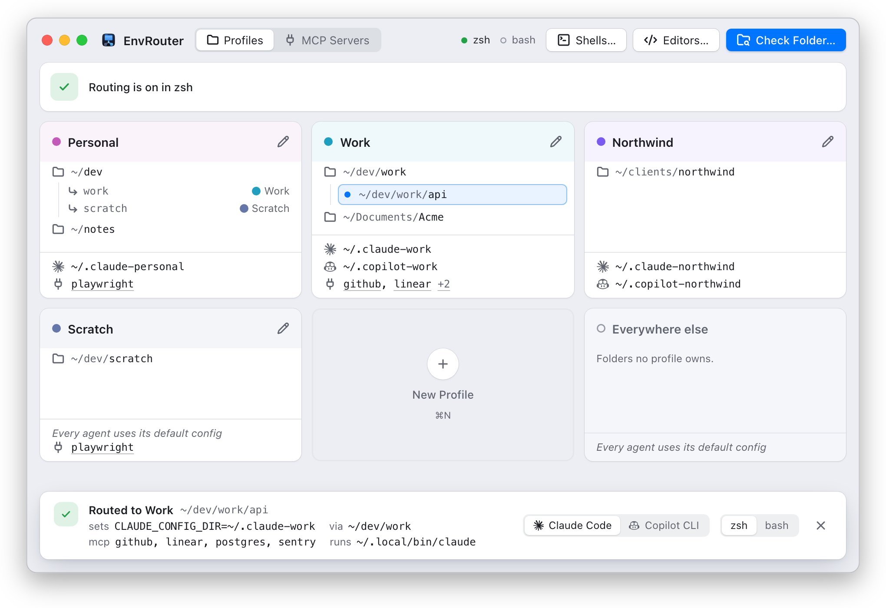
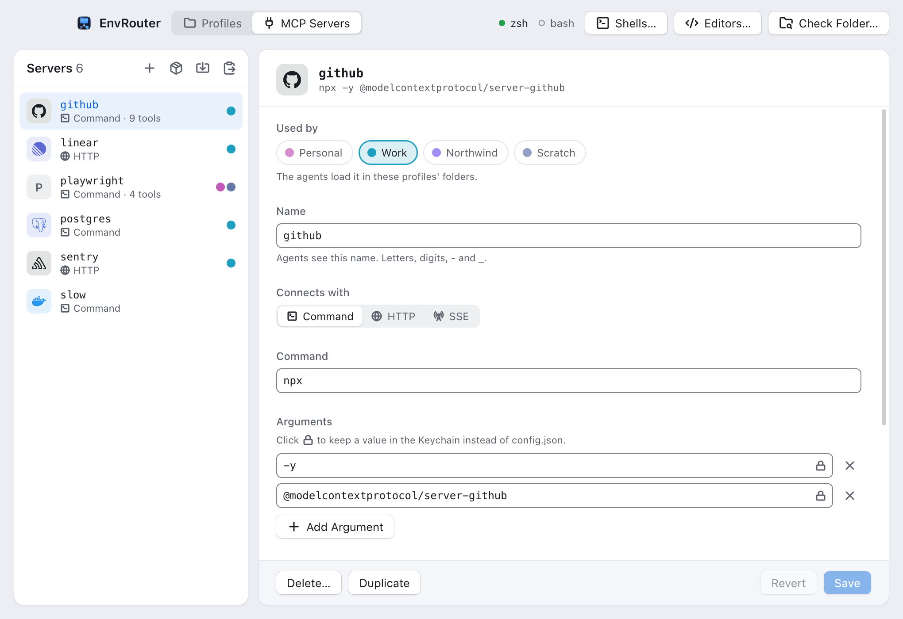

<p align="center">
  
</p>

<h1 align="center">EnvRouter</h1>

<p align="center">
  The right coding-agent account, and the right MCP servers, for the folder you're in.
</p>

<p align="center">
  <a href="https://github.com/pixel-perfect-software/env-router/actions/workflows/ci.yml"></a>
  <a href="https://github.com/pixel-perfect-software/env-router/releases/latest"></a>
  <a href="LICENSE"></a>
  
  <a href="https://github.com/pixel-perfect-software/homebrew-tap"></a>
  
</p>

<p align="center">
  <picture>
    <source media="(prefers-color-scheme: dark)" srcset="docs/images/check-dark.png" />
    
  </picture>
</p>

EnvRouter is for people who use more than one account with their coding agents. Run `claude` in
`~/dev/work` and it uses your work config with your work MCP servers; run it in `~/dev/personal`
and it uses your personal ones. There are no aliases to remember, no wrapper commands and
nothing to reload.

It's a desktop app for macOS and Linux, including WSL 2, and an `envrouter` command for machines
without a desktop.

You define **profiles**. Each profile has trigger folders, a config folder per agent, and a
selection of MCP servers from a library you keep in the app:

| Agent | Command | Variable EnvRouter sets | How it hands over MCP servers |
|---|---|---|---|
| Claude Code | `claude` | `CLAUDE_CONFIG_DIR` | `--mcp-config=<file>` |
| Copilot CLI | `copilot` | `COPILOT_HOME` | `--additional-mcp-config=@<file>` |

## ✨ Features

- 👤 **Per-folder accounts.** Each profile points an agent at its own config folder, so logins,
  settings and history stay separate. The deepest matching folder picks the profile.
- 🔌 **Per-folder MCP servers.** Keep one server library and choose which profiles load each
  server. Turn off individual tools per profile once a check has listed them.
- 📥 **Import, paste and catalog.** Bring in the servers your agents already define (EnvRouter only
  reads their files), paste a server's JSON straight from its README, search a catalog of nearly 90
  vendors' own servers (hosted or local, and what each needs to sign in), or add one by hand.
  Duplicate a server or a profile to start from one you have.
- 🔑 **Secrets in your system's store.** API keys and tokens you enter go to the macOS Keychain,
  the Linux keyring, or, inside WSL, the Windows Credential Manager. Never `config.json`, a
  rendered file or a command line.
- 🧩 **Editor extensions too.** Claude Code for VS Code (and in Cursor, Windsurf, VSCodium) runs
  its own copy of `claude`; **Editors…** routes it through EnvRouter as well, including VS Code
  connected to WSL or over SSH.
- 💻 **A CLI for headless machines.** `envrouter` sets up and checks routing on a server or in a
  WSL distro, without the window.
- 🔍 **Folder check.** Drop a folder on the window (or press ⌘O; Ctrl+O on Linux) and EnvRouter
  starts your shell the way a new terminal window would, then reports what running the agent
  there would really do, including an alias, a shell function, or a prompt hook (mise, direnv)
  getting in the way.
- 🪶 **No background process.** A small shim does the routing when you run a command. Config
  changes apply on the next run in every open terminal, with the app closed or open.
- 🛟 **Never in the way.** If the config is missing or broken, the agent still runs, without a
  profile. EnvRouter never signs you in to anything.

<p align="center">
  <picture>
    <source media="(prefers-color-scheme: dark)" srcset="docs/images/servers-dark.png" />
    
  </picture>
</p>

## 📋 Requirements

- **macOS** 11 or later, on Apple Silicon. Intel Macs should work the same way but haven't been
  tried, and the bundle is arm64-only for now.
- **Linux** on x86_64 or aarch64: Ubuntu 22.04 or newer, or a distro of the same age, and WSL 2.
  The app needs WebKitGTK 4.1, which the `.deb` installs. Secrets need a keyring (GNOME Keyring
  or KWallet); in WSL they go to Windows instead, through a helper that comes with EnvRouter.
- zsh, bash or fish.
- Claude Code and/or Copilot CLI, installed the usual way.

EnvRouter is pre-release. The macOS app is signed ad hoc rather than with a paid Apple Developer
ID, so it isn't notarized: install it with Homebrew, which clears the download's quarantine
flag, or build it yourself. Native Windows support is planned.

## 🚀 Install

### 🍎 macOS

With [Homebrew](https://brew.sh):

```sh
brew install --cask pixel-perfect-software/tap/envrouter
open /Applications/EnvRouter.app
```

### 🐧 Linux

From the [latest release](https://github.com/pixel-perfect-software/env-router/releases/latest),
take the `.deb` (Debian, Ubuntu and their relatives) or the AppImage (any distro) for your
architecture: `amd64`/`x86_64` or `arm64`/`aarch64`.

```sh
sudo apt install ./EnvRouter_<version>_amd64.deb     # then open EnvRouter from your apps
# or
chmod +x EnvRouter_<version>_amd64.AppImage && ./EnvRouter_<version>_amd64.AppImage
```

### 💻 The CLI

`envrouter` does the same setup without the window, for servers, WSL distros and scripts:

```sh
brew install pixel-perfect-software/tap/envrouter-cli
envrouter install          # the shim and helpers, into ~/.envrouter/bin
envrouter shell on zsh     # or bash, fish
```

On a Mac with the app installed, skip `envrouter install`: the app keeps `~/.envrouter/bin`
current itself. Without Homebrew, unpack `envrouter-cli-<version>-<target>.tar.gz` from the release (for example
`envrouter-cli-0.5.4-x86_64-unknown-linux-gnu.tar.gz`)
and run `./envrouter install` from that folder.

Every release comes with `SHA256SUMS`; `sha256sum -c SHA256SUMS --ignore-missing` checks the
files you downloaded.

The cask and formula come from [pixel-perfect-software/homebrew-tap](https://github.com/pixel-perfect-software/homebrew-tap).
Every build in a release comes from its tagged source, built by this repository's
[release workflow](.github/workflows/release.yml) on GitHub Actions. Installing by full name
trusts only that cask or formula, not the whole tap.

### 🔨 Build from source

You need, once:

1. On macOS, Xcode's command line tools: `xcode-select --install`. On Linux, a C toolchain and
   the WebKitGTK development packages: on Debian or Ubuntu, `sudo apt install build-essential
   libwebkit2gtk-4.1-dev libayatana-appindicator3-dev librsvg2-dev libxdo-dev`
2. Rust, from [rustup.rs](https://rustup.rs). The repository pins its toolchain in
   `rust-toolchain.toml`, and rustup installs that version on first build. (Homebrew's `rust`
   doesn't read the pin; if you use it, match the version by hand.)
3. Node.js 24 or later, from [nodejs.org](https://nodejs.org) or `brew install node`
4. pnpm: `npm install -g pnpm`. The project pins its own pnpm version, and pnpm fetches it.

(With [asdf](https://asdf-vm.com), `asdf install` sets up the Node and pnpm versions pinned in
`.tool-versions` instead of steps 3 and 4.)

Then clone and build:

```sh
git clone https://github.com/pixel-perfect-software/env-router.git
cd env-router
pnpm install
pnpm tauri build
# macOS: copy the app into Applications
ditto target/release/bundle/macos/EnvRouter.app /Applications/EnvRouter.app
open /Applications/EnvRouter.app
# Linux: install the package it built
sudo apt install ./target/release/bundle/deb/EnvRouter_*.deb
```

For the CLI alone, `cargo build --release -p envrouter-cli -p envrouter-shim -p envrouter-keychain`
and then `target/release/envrouter install`. The first build takes a few minutes.

## 🧭 Getting started

1. **Create a profile** (⌘N; Ctrl+N on Linux). Give it a name, add its trigger folders with
   **Add Folder…**, and set a config folder for each agent you want to route, such as
   `~/.claude-work`. EnvRouter creates missing config folders inside your home folder when you
   save.
2. **Turn on your shell.** Click the shell status in the toolbar (the `zsh` and `bash` dots) and
   switch on the shells you use. This adds a marked block to the end of each startup file that
   puts EnvRouter's shims first on `PATH`.
3. **Open a new terminal window,** `cd` into a trigger folder and run `claude` or `copilot`.
   A new config folder starts logged out, so sign in once there as usual.
4. **Check it.** Drop a folder on the window, or press ⌘O (Ctrl+O), to see which profile a new
   terminal window would use there and what it would set. From a terminal, `envrouter check`
   does the same, and `ENVROUTER_EXPLAIN=1 claude` prints the route as JSON instead of running
   Claude.

To route an editor extension, open **Editors…** (the `</>` button in the toolbar) and switch on
the editor. It points the extension's process-wrapper setting (`claudeCode.claudeProcessWrapper`
for Claude Code) at EnvRouter; new sessions in that editor then use the folder's profile.
EnvRouter never replaces a wrapper you set yourself. The button appears once EnvRouter finds an
editor with an agent extension it can route.

To start a profile from one you have, right-click its card and choose **Duplicate Profile…**
(or **Duplicate** in its editor). The copy keeps the agents, servers and turned-off tools, but no
folders, since a folder belongs to one profile.

## 🔌 MCP servers

Switch to **MCP Servers** (⌘2; Ctrl+2). The list on the left is your server library; the editor
beside it changes one server at a time. A server reaches an agent only in the folders of the
profiles that use it.

### ➕ Add a server

- **Add from Catalog** (the package icon): search the vendors' own servers. Filter by where they
  run (**Hosted** by the vendor, or **Runs locally** on your machine) and by what they need
  (**No sign-in**, **Sign-in**, **Secret**). Picking one opens the editor filled in, with any
  secret fields empty and the expected format as a hint.
- **Import from Your Agents** (the import icon): lists the servers your agents already define, in
  Claude Code's `.claude.json` (your home folder and each profile's config folder) and any
  `.mcp.json` in a trigger folder, and in Copilot's `mcp-config.json`. Tick the ones to bring in.
  Values that look like credentials go to your system's secret store, and Docker or Podman
  servers get `--init` so the container stops with the agent. EnvRouter never changes those
  files, and a server already in the library is shown as such.
- **Paste JSON** (the clipboard icon): paste a server's config as its README or an agent's file
  writes it: an `mcpServers` block, VS Code's `servers`, a bare table of servers, or one server on
  its own. Comments and trailing commas are fine. One server opens in the editor; several open
  the import review. ⌘Return (Ctrl+Return) continues.
- **Add Server** (the plus): fill in the editor by hand. **Connects with** picks a command the
  agent starts (with arguments and environment variables), or a URL (HTTP or SSE) with headers.

### 👥 Choose which profiles use it

Switch a profile on in the server's **Used by** row, or tick the server in the profile's own
**MCP servers** checklist. Both change the same thing. Each profile card lists its servers;
click a name to open it.

### 🔑 Keep secrets out of config.json

Every value field has a lock at its right edge. Click it to keep that value in the macOS
Keychain, the Linux keyring or, in WSL, the Windows Credential Manager, instead of
`config.json`. A new value under a name like `API_KEY` or `Authorization` starts locked. A stored
value shows as **In Keychain** (**In the keyring**, **In the Credential Manager**) and is never
shown again; **Replace**
sets a new one. EnvRouter also warns when a value that looks like a credential would be saved as
plain text, such as an `--api-key=` argument or a password in a connection string.

Copilot CLI expands `${VAR}` in environment variables and headers but not in arguments, so give
a server its secret through an environment variable or a header rather than an argument.

### 🧰 Check a server and turn tools off

**Check Server** starts the server (or calls its URL), lists its tools and stops it again. Once a
server has been checked, each profile that uses it can turn individual tools off: open the
profile, expand the server's **All 9 tools** line under **MCP servers**, and untick tools, or use
**All On** and **All Off**. A tool turned off in a profile stays available in the others.

Remote servers that need a login sign in through the agent (`/mcp` in Claude Code), not through
EnvRouter. **Duplicate** in the editor's footer starts a new server from this one, with its
secret fields empty; **Delete…** removes it from the library and from every profile.

On macOS, EnvRouter lives in the menu bar: closing the window only hides it; quit from the menu
bar icon. On Linux, closing the window quits; routing keeps working without it.

## ⌨️ CLI commands

`envrouter` runs the same operations as the window:

| Command | Does |
|---|---|
| `envrouter` or `envrouter status` | The shim, each shell and editor, and the config |
| `envrouter install` | Installs the shim, the secrets helper and the CLI into `~/.envrouter/bin`, and a shim per agent |
| `envrouter shell on\|off <zsh\|bash\|fish>` | Adds or removes the block in that shell's startup files |
| `envrouter editor on\|off <editor> [--agent <command>]` | Routes an editor extension (`code`, `cursor`, `remote-code` for the VS Code Server, …) |
| `envrouter check [folder] [--tool <command>] [--shell <shell>]` | Starts a shell the way a new terminal would and reports what running the agent there does; exits 1 unless it's routed |
| `envrouter explain [folder] [--tool <command>]` | Which profile the saved config picks, without starting a shell |
| `envrouter apply` | Validates `~/.envrouter/config.json` after you edit it by hand, and renders its MCP files and shims |
| `envrouter secret set <ID>` | Stores the value of a server's secret in the system's store: piped in, or typed without echo; never on the command line |
| `envrouter secret list` | Each secret the config refers to, the servers that use it, and whether it's stored (`unknown` when the store can't be read) |
| `envrouter rpc` | Answers the window's commands as JSON lines, one per line each way, so another program (later, a window managing a WSL distro) can drive this machine |

`--tool` defaults to `claude`; pass `--tool copilot` for Copilot CLI. `--shell` defaults to your
login shell. Add `--json` to any command for machine-readable output.

### 📝 Without the window

On a server or in a WSL distro, write `~/.envrouter/config.json` yourself and run
`envrouter apply`. A profile names its trigger folders, a config folder per agent and the
library servers it loads; a value kept in the secret store is written `{ "secret": "<ID>" }`,
with an ID of uppercase hex:

```json
{
  "version": 3,
  "profiles": [
    {
      "id": "work",
      "name": "Work",
      "triggerPaths": ["~/dev/work"],
      "tools": {
        "claude": { "envVar": "CLAUDE_CONFIG_DIR", "path": "~/.claude-work" },
        "copilot": { "envVar": "COPILOT_HOME", "path": "~/.copilot-work" }
      },
      "mcpServers": { "github": { "disabledTools": [] } }
    }
  ],
  "mcpServers": {
    "github": {
      "transport": "stdio",
      "command": "npx",
      "args": ["-y", "@modelcontextprotocol/server-github"],
      "env": { "GITHUB_PERSONAL_ACCESS_TOKEN": { "secret": "A1" } }
    }
  }
}
```

```sh
envrouter apply                 # validates it, fills in what each agent needs, renders the MCP files
envrouter secret set A1         # paste the token, then Return (or: … secret set A1 < token.txt)
envrouter explain ~/dev/work    # Work: CLAUDE_CONFIG_DIR=~/.claude-work, with MCP servers github
```

A hand-written config doesn't need the `agents` section: `apply` adds each agent's MCP and
editor details to it, and `install` and `editor` use them without saving. The CLI only fills in
agents the config doesn't name yet, and where the app is installed it leaves the app's own shim
and helper in place.

## 🪟 Using EnvRouter in WSL

A WSL 2 distro is a Linux machine: install EnvRouter inside it, not on the Windows side.

1. **Install inside the distro:** the CLI (`brew install pixel-perfect-software/tap/envrouter-cli`,
   or the release archive), then `envrouter install` and `envrouter shell on bash` (or your
   shell), and set up profiles [without the window](#-without-the-window). The `.deb` works too;
   its window opens on your Windows desktop through WSLg.
2. **Secrets go to the Windows Credential Manager.** A distro usually has no keyring of its own,
   so EnvRouter's Windows helper (`~/.envrouter/bin/envrouter-keychain.exe`, installed with the
   rest) keeps them on the Windows side, per distro. It needs WSL's Windows interop, which is on
   by default. Store one with `envrouter secret set <ID>`, or in the window.
3. **VS Code on Windows, connected to the distro,** runs the Claude Code extension inside WSL.
   Route it with `envrouter editor on remote-code` (or **Editors…** › **VS Code Server**), which
   sets the wrapper in the distro's server settings.
4. **Keep repositories in the Linux filesystem** (`~/…`), not under `/mnt/c`: Windows drives are
   slow to resolve from WSL, and their folder names aren't case-sensitive.

## ⚙️ How it works

EnvRouter uses shims, like [mise](https://mise.jdx.dev) or [Volta](https://volta.sh).

- `~/.envrouter/shims/<tool>` is a symlink to `~/.envrouter/bin/envrouter-shim`, a small Rust
  binary.
- A marked block at the end of your shell startup file puts `~/.envrouter/shims` first on `PATH`.
- Each time you run a tool, the shim reads `~/.envrouter/config.json`, finds the profile for the
  current folder, sets that tool's variable, adds that profile's MCP servers to the command
  line, and `exec`s the real tool found later on `PATH`.
- When you save, the app writes each profile's MCP server files in each agent's own format, so
  servers keep working with the app closed. When a server needs a secret, the shim asks a small
  helper, `envrouter-keychain`, to read it from the system's store and passes it to the agent in
  its environment.
- An editor extension that runs its own copy of the agent runs it through the shim instead
  (`envrouter-shim <its binary> <args>`, or `<interpreter> <script> <args>` for a build that
  ships a script), so the same routing applies there.

**The most specific folder wins outright.** The deepest trigger folder containing the current
folder picks the profile. If that profile doesn't set the tool you're running, the tool runs
with its default config; it does not fall back to a profile further up. Folders are compared
after resolving symlinks and letter case, and a trigger covers its whole subtree.

### 📁 Files EnvRouter creates

| Where | What |
|---|---|
| `~/.envrouter/config.json` | Your profiles and server library |
| `~/.envrouter/bin/` | The shim and the secrets helper (on Linux also its Windows build, for WSL), and the CLI if you installed it from a release archive; updated by the app when it starts |
| `~/.envrouter/shims/` | One symlink per routed command |
| `~/.envrouter/mcp/` | Rendered MCP server files per profile and agent (readable only by you) |
| `~/.envrouter/mcp-tools.json` | Tool lists from server checks |
| "EnvRouter MCP secrets" in the system's store | Secret values you've entered, once there are any: in the login Keychain on macOS, the keyring on Linux, the Windows Credential Manager from WSL |
| Shell startup files | A block between `# >>> envrouter >>>` and `# <<< envrouter <<<` in `~/.zshrc` (or `$ZDOTDIR/.zshrc`); for bash, `~/.bashrc` on a Linux desktop, or the login file (and `~/.bashrc`) on macOS and in WSL; or fish's `config.fish` |
| An editor's settings | `claudeCode.claudeProcessWrapper`, once you turn the editor on in **Editors…** |

Your agents' own config folders are yours; EnvRouter only creates missing ones.

### 🔒 Privacy and security

EnvRouter has no account, no telemetry and no background process. It makes network requests
only when you check a remote MCP server. Secret values never appear in `config.json`, in a
rendered file or on a command line, and the window never reads them back once they're saved.

## 🩺 Troubleshooting

| Problem | Try |
|---|---|
| The agent ignores the profile | Check the folder in the app (⌘O, Ctrl+O) or with `envrouter check`. It names what's in the way: the shell block is off, an alias or function, another copy earlier on `PATH`, or a prompt hook (mise, direnv) moving one ahead. Remember to open a new terminal window after turning a shell on. |
| You want to see what the shim would do | `ENVROUTER_EXPLAIN=1 claude` (or `copilot`) prints the profile, variable, MCP servers and real binary as JSON, without running the tool. |
| You want one run without EnvRouter's MCP servers | `ENVROUTER_MCP=0 claude`, or pass `--strict-mcp-config` to `claude`. |
| An MCP server doesn't show in `claude mcp list` or `copilot mcp list` | Expected: those commands don't list servers passed on the command line. Use `/mcp` inside the agent. |
| Saving a secret fails on Linux with "there's no Secret Service" | Install and start GNOME Keyring or KWallet, then save again. Servers that need a secret are left out until then; the rest still load. |
| Saving a secret fails in WSL with "couldn't reach the Windows Credential Manager" | Run `envrouter install` so `~/.envrouter/bin/envrouter-keychain.exe` is there, and check that WSL interop is on (`[interop] enabled` isn't `false` in `/etc/wsl.conf`). |
| macOS says EnvRouter can't be opened | The app is signed ad hoc, not notarized. Homebrew's cask clears the quarantine flag that triggers this; for a copy you downloaded or built elsewhere, run `xattr -dr com.apple.quarantine /Applications/EnvRouter.app`. |

## 🔄 Updating

With Homebrew, `brew upgrade --cask envrouter` for the macOS app (it quits EnvRouter first; open
it again afterwards), and `brew upgrade envrouter-cli` for the CLI, followed by `envrouter
install` where the CLI is what installed the shim. On Linux, install the new `.deb` or AppImage
over the old one. From source, pull the latest code,
quit EnvRouter, and run the build and install commands again. When a new version of the app
starts, it updates the shim and helpers in `~/.envrouter/bin` itself.

## 🗑️ Uninstall

1. Turn every shell off, from the toolbar's shell status or with `envrouter shell off <shell>`.
   This removes the marked block from each startup file. You can also delete the lines between
   `# >>> envrouter >>>` and `# <<< envrouter <<<` by hand.
2. If you turned on an editor, turn it off (**Editors…**, or `envrouter editor off <editor>`).
   This removes `claudeCode.claudeProcessWrapper` from that editor's settings.
3. Remove the app: on macOS quit it and run `brew uninstall --cask envrouter` (or delete
   `/Applications/EnvRouter.app`); on Linux `sudo apt remove env-router`, or delete the AppImage.
   Remove the CLI with `brew uninstall envrouter-cli`.
4. Delete `~/.envrouter` (on macOS, `brew uninstall --zap --cask envrouter` does steps 3 and 4).
5. If you stored MCP secrets, delete them from the store:
   - macOS: the "EnvRouter MCP secrets" item in Keychain Access, or
     `security delete-generic-password -s "EnvRouter MCP secrets"`
   - Linux: `secret-tool clear service "EnvRouter MCP secrets"`
   - WSL: in Windows, the "EnvRouter MCP secrets:wsl:…" entries under Windows Credentials in
     Credential Manager (`cmdkey /list` shows them; `cmdkey /delete:<name>` removes one)

Your agents' config folders are left alone.

## 🤝 Contributing

Contributions are welcome. EnvRouter is built with Tauri 2, Rust and React; see the
[contributing guide](docs/contributing.md) for setup, the development commands, how to review the
UI safely in a browser, and the project layout.

## 💸 Support this project

<a href="https://www.buymeacoffee.com/tylernrobertson" target="_blank"></a>

## 📝 License

Copyright © 2026 [Tyler Robertson](https://github.com/TylerNRobertson) and [Pixel Perfect Software Inc.](https://github.com/pixel-perfect-software)

EnvRouter is free software under the [GNU General Public License v3.0 or later](LICENSE). You can
use, study, change and share it. If you distribute it, changed or not, you must share its
source under the same licence, so nobody can ship a closed-source copy. Releases up to v0.4.0
were published under the MIT licence.
